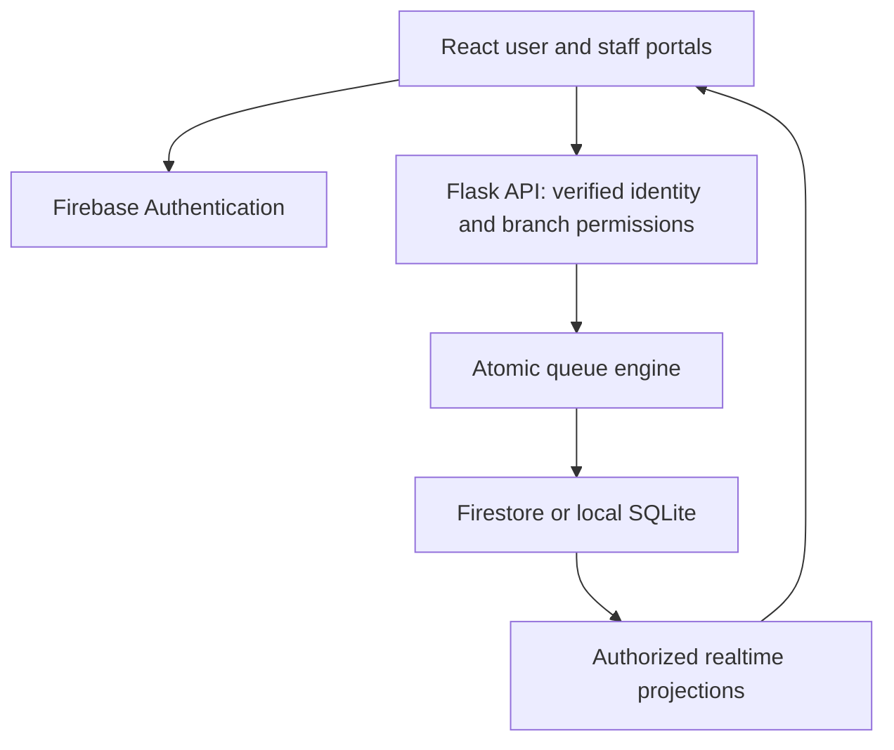

# TokenFlow

**Less waiting. More living.** A five-service queue platform with a violet/lime Gen Z interface, original vector ticket-arrow logo, customer tickets, QR codes, staff controls, analytics, and a Python queue engine.

## What's included

- Five categories: Banks, Hospitals, Police Stations, Government/NADRA, and Utility Centers. One sample branch per category; two service types per branch.
- Fifteen seeded counters (two open and one closed for each branch). Counters handle both service types within their branch.
- Customer token generation, duplicate retry protection, live tracking, cancellation, QR codes, branch check-in QR, and print/save-to-PDF tickets.
- Staff call-next, start, complete, no-show, rejoin-at-end, and counter controls. Admin add-counter and edit-branch controls; API also supports adding departments.
- Measured waiting/service averages, completed-by-counter chart, queue history, notifications, and controlled simulated arrivals.
- Separate browser showcase, local Flask/SQLite demo, and Firebase-connected mode. No silent fallbacks between modes.

## Architecture



```text
frontend/
  src/main.jsx                 user and admin screens
  src/styles.css               responsive design system
  src/api.js                   explicit API/Firebase/showcase adapters
  src/demo.js                  browser-only synthetic showcase
  src/router-showcase.jsx      offline showcase routing
  src/qr-showcase.js            independently verified offline QR encoder
  public/logo.svg              original scalable TokenFlow logo + favicon
  vite.config.js               normal React build
  vite.showcase.config.js      offline showcase build
backend/
  app.py                       HTTP validation, endpoints, CORS, rate limiting
  auth.py                      Firebase verification and local demo sessions
  storage.py                   atomic Firestore and SQLite adapters
  services/engine.py           deterministic queue and analytics logic
  services/notifications.py    optional SMS provider adapter
  tests/                       core and API tests
  seed.py                      explicit synthetic arrivals
  create_admin.py              trusted role bootstrap
firebase/                      deny-by-default rules and index configuration
render.yaml                    Python deployment blueprint
vercel.json                    static frontend deployment configuration
```

## 1. Run the complete local frontend + backend

Prerequisites: Node 22.13+ and Python 3.10+; internet access for package installation.

In terminal 1, from the project root:

```bash
cd backend
python -m venv .venv
# macOS/Linux:
source .venv/bin/activate
# Windows PowerShell instead: .venv\Scripts\Activate.ps1
pip install -r requirements.txt
cp .env.example .env
# Windows instead: Copy-Item .env.example .env
```

Edit `backend/.env`: choose a random `SECRET_KEY`, keep `STORE_MODE=sqlite`, and use `SIMULATION_ENABLED=true` for the demonstration. Generate a key with `python -c "import secrets; print(secrets.token_hex(32))"`. Do not commit `.env`.

```bash
python seed.py
python app.py
```

In terminal 2:

```bash
cd frontend
npm install
cp .env.example .env
# Windows instead: Copy-Item .env.example .env
npm run dev
```

Open **http://localhost:5173**. Default `.env.example` uses `VITE_APP_MODE=api` and the Vite proxy routes `/api` to Flask on port 5000. Choose **User** to create an account with your name, email, and password, or log in to an existing account. Choose **Admin** to log in; on a fresh local database, create Admin access once and save the random email/password shown at setup. The generated credentials are displayed only once. User passwords are stored as hashes in SQLite, and each account sees only its own tickets. The old shared demo password and guest session are no longer accepted.

Never expose SQLite/demo-admin mode as a public production service. SQLite mode is a local hackathon alternative, not a substitute for configured Firebase authentication.

## 2. Try the browser-only showcase

Use `VITE_APP_MODE=showcase` (or leave all frontend environment files absent) and run `npm run dev`. The hosted preview uses this mode and stores synthetic demo accounts and data in localStorage. User accounts are local to that browser; Admin setup generates random credentials for the local simulation only. It cannot reach real accounts or records. Reset demo tickets from Settings.

Tickets are limited to this browser. A QR opened on another device will not find browser-local data. The Firebase/API version requires the ticket owner's authenticated session. QR payloads contain only opaque ticket IDs and URLs, not customer names or phone numbers.

## 3. Connect Firebase

1. Create a Firebase project and a Firestore database. Enable Email/Password Authentication for Users and Admins.
2. Register a web app. Copy its public configuration into the frontend `VITE_FIREBASE_*` variables. Set `VITE_APP_MODE=firebase`.
3. Generate a server service account and keep its JSON **outside the repository**. Set `GOOGLE_APPLICATION_CREDENTIALS` to that file's absolute path. Never paste its private key into frontend variables.
4. Set backend `STORE_MODE=firestore`; set `FRONTEND_ORIGIN` to your exact frontend origin. Disable simulation for real service use (`SIMULATION_ENABLED=false`).
5. Deploy rules/indexes using Firebase CLI: `firebase use YOUR_PROJECT_ID`, then `firebase deploy --only firestore`.
6. Users can register through the app. Create an Admin user in Firebase Authentication, then run `python create_admin.py --email YOUR_EMAIL` to assign the trusted Admin role. Only trusted operators with server credentials can run this command; client-side Admin setup is intentionally unavailable in Firebase mode.
7. Start Flask. Open the frontend. The first persisted change initializes the queue aggregate and public summary. To initialize with synthetic data, explicitly enable simulation, run `seed.py`, and turn simulation back off.
8. Add your frontend domain in Firebase Authentication's authorized domains. Use HTTPS for deployment.

The frontend subscribes to the non-personal Firestore summary revision and re-fetches authorized data from Flask; five-second polling also keeps elapsed-time estimates moving. Direct token projections are owner/staff readable and client write-protected. All writes go through Flask. Guest Firebase identities persist in the browser, so clearing browser data loses access to anonymous tickets; cross-device customer account migration is not included in this MVP.

### Bounded Firestore model

For this hackathon MVP, a single private aggregate document stores authoritative departments, counters, tickets, service records, and a bounded event history. Each mutation reads and updates it transactionally, then writes the public summary and owner-protected token projections in the same transaction. This provides cross-process concurrency protection without half-updated queues.

The dataset is intentionally capped at **250 total tickets**, 20 departments, and 60 counters. Completed tickets count toward the cap. The timestamp fields use server-generated Unix seconds in UTC (not browser time); Firestore `updatedAt` metadata also uses SERVER_TIMESTAMP. This differs from a large production normalized schema intentionally. Before public rollout, partition by branch, archive completed tickets, store service/notification records separately, add distributed rate limiting, and load-test contention. Do not remove caps without revisiting Firestore document and transaction limits.

## Queue behavior

- FIFO by server-issued queue sequence. Human ticket numbers and opaque QR identifiers are distinct.
- One active ticket per customer per branch; idempotency keys prevent duplicate POST retries.
- Call-next reserves a free open counter atomically. Start-service records waiting time. Complete records measured service time and releases the counter.
- Closing a busy counter preserves its customer but stops new assignments.
- No-show applies to called tickets. Rejoin puts a skipped ticket at the end, with its original displayed ticket number.
- Waiting estimates simulate each available counter's future workload using the last 30 service durations, or a per-service default. Busy counters use estimated remaining time, with a 30-second minimum when overdue.
- Zero eligible open counters returns a paused estimate, not zero minutes. This is a routine-service system, not emergency dispatch or clinical triage.

## Notifications and SMS

In-app/browser alerts fire when three or fewer people are ahead. Browser permission is requested only on a click; the page must remain open. Backend event timestamps deduplicate each approach event, and browser session storage prevents repeated display of the same event.

The optional Twilio adapter in `services/notifications.py` handles provider acceptance/failure without invalidating tickets. It is **not wired to automatic sends**: no phone numbers are collected in the MVP and no SMS is sent by the demo. To enable real SMS, integrate validated E.164 phone collection and explicit consent with a durable outbox/deduplication worker and delivery callbacks before calling the adapter. The core app requires no SMS provider or paid service.

## API

All replies are `{success:true,data:...}` or `{success:false,message:...}`. Protected routes use `Authorization: Bearer <ID token>`; identity/role/branch checks are server-side.

| Method | Route | Access |
| --- | --- | --- |
| GET | /api/health, /api/departments, /api/queue/:department | Public, non-personal summary |
| POST | /api/auth/register, /api/auth/login | SQLite demo only |
| GET, POST | /api/auth/admin/setup-status, /api/auth/admin/setup | SQLite first-Admin bootstrap; setup is one-time |
| GET | /api/me | Authenticated identity |
| GET, POST | /api/tokens | Owner's list; create ticket |
| GET | /api/tokens/:opaqueId | Owner or Admin |
| POST | /api/tokens/:id/cancel | Owner, waiting only |
| GET | /api/dashboard, /api/analytics | Admin |
| POST | /api/counters/:id/open, /close, /next | Admin |
| POST | /api/queue/next | Admin; counterId body |
| POST | /api/tokens/:id/start, /complete, /skip, /recall | Admin |
| POST | /api/departments | Admin; id to edit, omit id to create |
| POST | /api/counters | Admin; departmentId and name |
| POST | /api/simulate | Admin + enabled simulation; count 1–10 |

## Tests and validation

```bash
cd backend
python -m unittest discover -s tests -p '*stdlib.py' -v
# With requirements installed:
python -m pytest -q
cd ../frontend
npm run build
node tests/demo.test.mjs
```

Validation performed in the creation environment:
- 10 standard-library Python queue/storage tests passed, including threaded concurrent writes.
- Browser showcase build passed using cached dependencies.
- JavaScript demo-flow tests passed (see tests/demo.test.mjs).
- Offline QR matrix matched ReportLab's independent version-6/L implementation.
- Python source compiled successfully.

Limitations of that environment: external pip/npm downloads were restricted, so Flask HTTP integration tests and live Firebase integration could not be run. The full normal Firebase build needs the dependencies from package.json. Browser visual QA was unavailable. The published showcase is not a deployed Python backend.

### Manual demo checklist

1. Create a User account; select Banks → choose service → Generate my ticket. Confirm QR, position, wait, and print layout.
2. Sign out, then choose Admin. Create and save the temporary Admin credentials on first setup, or log in with existing credentials.
3. Add five visitors; observe the queue/chart change. Open Counter 03; wait estimates should decrease or remain equal.
4. Call next → Start service → Complete. Repeat until your ticket is near the front; observe the alert.
5. Close a busy counter; its current customer must remain assigned. Complete that service; the closed counter must reject call-next.
6. Mark a called visitor no-show; rejoin; verify they move to the back.
7. Cancel your own waiting ticket. Verify another owner's ticket is denied in API mode.
8. Refresh; verify persistence. Test narrow/mobile view, keyboard navigation, and QR scanning.

## Deployment

**Frontend / Vercel:** import the repository root; use the supplied vercel.json. Set `VITE_APP_MODE=firebase`, Firebase web configuration, and `VITE_API_URL=https://YOUR_BACKEND/api` before building. Vite embeds configuration at build time. Normal build uses React Router, Firebase SDK, and the qrcode package.

**Backend / Render:** use render.yaml or create a Python service with root `backend`, build `pip install -r requirements.txt`, and start `gunicorn 'app:create_app()' --bind 0.0.0.0:$PORT --workers 1`. Upload the service-account JSON as a secret file at `/etc/secrets/firebase-service-account.json`. Set the exact frontend origin. Use Firestore for durable deployed storage. Do not commit credentials.

**Hosted Sites preview:** static showcase only; Python cannot execute on this static host. Source includes the full Python deployment path above. No real backend/Firebase deployment is claimed.
